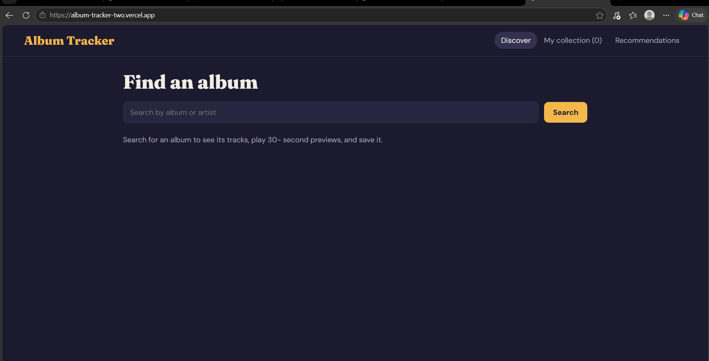

// Album Tracker

Album Tracker is a web application designed to help music lovers to discover, collect, and explore music efficiently. Built with React and powered by external music APIs, the app allows users to search for albums, preview audio tracks, manage a personalized collection saved directly in their browser, and receive recommendations powered by Google's Gemini AI.

// Screenshot and Live link

- Live Link: (https://album-tracker-amparo.vercel.app)

// Features

- Search & Discover: You can Search for albums and artists with real-time data powered by the iTunes API.
- Audio Previews: You can listen to 30-second track previews directly within the app player.
- Personal Collection: You can save your favorite albums to a personal collection.
- AI Recommendations: Get personalized album suggestions powered by Google's Gemini AI based on your saved collection.
- Responsive Navigation: Clean navigation bar featuring dynamic item counters for your collection.

// Tech Stack

- Frontend: React, Vite
- State Management: React Context API
- External Data & Media: iTunes Search API, Deezer API
- AI Integration: Google Gemini API
- Deployment & Hosting: Vercel

// How to Run Locally

   git clone [https://github.com/Roim24/album-tracker.git](https://github.com/Roim24/album-tracker.git)
   cd album-tracker

// Limitations

- 30-Second Previews: Audio playback is limited only upto 30-second sample previews provided by external APIs.
- Browser-Only Storage: Collections are saved only in your browser.
- External Player Constraints: Deezer requires a login for full tracks.

// Privacy Note & Disclaimer

- Privacy Note: Prompts sent to the AI recommendations feature utilize album data from your collection to generate suggestions. 
- Disclaimer: This project is not affiliated with, authorized, maintained, sponsored, or endorsed by Apple, Spotify, Deezer, or Google.